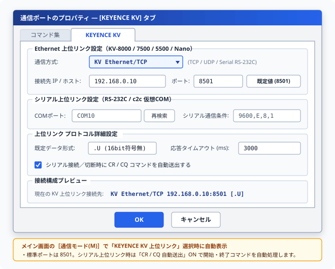
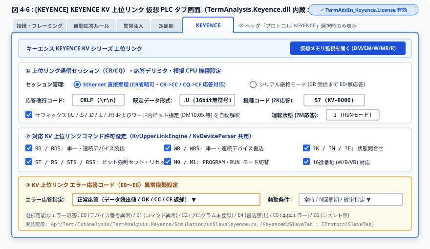

# Keyence（キーエンス KV 上位リンク）アドイン取扱説明書

👉 [← TermAddIn_Keyence 製品トップに戻る](../README.md)  
👉 [← プロパティ設定画面取扱説明書（共通）](../プロパティ設定画面取扱説明書.Md) ／ [← TermEmulator 操作説明書（共通）](https://github.com/Monaca-App/TermEmulator/blob/main/Manual/TermEmulator操作説明書.Md) ／ [← マクロスクリプト取扱説明書（共通）](../マクロスクリプト取扱説明書.Md)

---

本書は、**TermAddIn_Keyence**（`TermAnalysis.Keyence.dll`：キーエンス KV 上位リンク Ethernet TCP/UDP・RS-232C シリアル通信エクステンション）の **取扱説明書 兼 機能解説書** です。KV 上位リンクの基礎仕組み、プロパティ設定画面の **「KEYENCE KV」タブ**、**TermEmulator の `[KEYENCE]` 仮想スレーブタブ**、および全 9 コマンドのリファレンスを 1 冊にまとめています。

* **必須拡張ライセンス**: **`TermAddIn_Keyence.License`** （組み込み先: `TermAnalysis.Keyence.dll`、`TermEmulator` と相互共用）


### 関連する公式規格・メーカー仕様書（外部リンク）
* [キーエンス PLC（KV シリーズ）公式製品ページ](https://www.keyence.co.jp/products/controls/plc-building/) ／ [キーエンス公式サポートトップ](https://www.keyence.co.jp/support/) — 各シリーズ（KV-8000 / KV-7500 / KV-5000 / KV-Nano 等）のユーザーズマニュアル（上位リンク通信仕様・コマンド一覧・エラーコード `E0`〜`E6`）を参照できます（ダウンロードには無料の KEYENCE ID 登録が必要）。
* ※ お手元の **KV STUDIO** からも、メニューの **`[ヘルプ] ➔ [関連マニュアル] ➔ [マニュアル一覧を表示]`** より使用機種の通信マニュアルを直接確認できます。
---

## 目次

- [1. 機能概要と基礎知識（はじめての方へ）](#1-機能概要と基礎知識はじめての方へ)
- [2. プロパティ設定画面：「KEYENCE KV」タブの詳細](#2-プロパティ設定画面keyence-kvタブの詳細)
- [3. TermEmulator 仮想スレーブ設定：「[KEYENCE]」タブの詳細](#3-termemulator-仮想スレーブ設定keyenceタブの詳細)
- [4. マクロコマンド一覧（全 9 コマンド）](#4-マクロコマンド一覧全-9-コマンド)

---

## 1. 機能概要と基礎知識（はじめての方へ）

### 対応する機能の概要
**Keyence（キーエンス KV 上位リンク）** アドインは、キーエンス製 PLC（KV-8000 / KV-7500 / KV-5000 / KV-Nano シリーズ等）に対して、**Ethernet（TCP / UDP 標準ポート `8501`）** および **RS-232C シリアル上位リンク** の全 3 方式に対応し、データメモリ（`DM`, `EM`, `FM`, `ZF`, `W` 等）やリレー（`R`, `MR`, `LR`, `B`、ワード内ビット `DM100.05` 等）の読み書き、ならびに機種・運転状態照会（`?K`, `?M`, `?E`）を行う通信機能です。

### 機能の実現方法
* **上位リンク ASCII 電文・サフィックス・セッションの自動制御**: キーエンス固有の上位リンク命令（`RD`/`RDS`、`WR`/`WRS`、`ST`/`RS`）の自動選択、数値表現サフィックス（`.U`/`.S`/`.H`/`.D`/`.L`）の自動付与、およびシリアル接続時のセッション開始／終了コマンド（`CR` ➔ `CC` / `CQ` ➔ `CF`）をアドイン内部で自動実行します。
* **わかりやすい高水準マクロコマンド**: 利用者は内部のコマンド構文や改行コード（`\r`）を覚えなくても、`Kv_ReadWord, "DM100", 1, "VAL", "DEC"` のようにデバイス名と点数を書くだけで読み書きできます。
* **仮想 KV PLC による実機レス検証**: `TermEmulator` の `[KEYENCE]` タブで Ethernet 直接受理・シリアル厳格モード・エラー応答（`E0`〜`E6`）を模擬でき、設備を止めずにテストできます。

### このアドインを選択することの利点
* **専用通信ミドルウェア（KV COM+ 等）や追加ドライバ不要**: KV STUDIO 側で特別なラダープログラム（通信用ラダー）を書かなくても、PLC 標準の上位リンクポート（`8501`）へ繋ぐだけですぐに Excel から読み書きできます。
* **データ形式ミス・シリアル手順ミスを未然に防止**: 符号あり／なし・32 ビット変換やシリアル `CR/CQ` セッション制御をエンジン側が吸収するため、初心者でも数値解釈の誤りや無応答といったトラブルを未然に防ぐことができます。
* **Ethernet と RS-232C で手順を共通化**: 接続先を LAN からシリアルへ切り替えても、`Kv_ReadWord` / `Kv_WriteWord` 等のシーケンス本文を書き直す必要がありません。

### 「KV 上位リンク」の仕組み（なぜ扱いやすいのか）
* キーエンス KV シリーズの「上位リンク通信」は、難しいバイナリ電文ではなく、人間にも読める短い文字（例: `RD DM100`＝DM100 を読む、`WR DM100 123`＝DM100 に 123 を書く）でやり取りする仕組みです。
* **本アドインを使えば、そうした内部コマンドを意識せず** `Kv_ReadWord` / `Kv_WriteWord` / `Kv_ReadBit` / `Kv_WriteBit` だけで安全に読み書きできます。

### 設定の妥当性を判断するためのチェックポイント
プロパティ画面の各設定が正しいかどうかは、キーエンス製ソフト **「KV STUDIO」のユニット設定** と照らし合わせて以下の 4 点を確認すれば判断できます。

| 確認項目 | 項目の意味 | 設定値の目安・確認方法 |
| :--- | :--- | :--- |
| **通信方式（TCP / UDP / Serial）** | どのケーブル・手順で繋ぐか | LAN ケーブルで繋ぐ場合は **`KV Ethernet/TCP`** が最も確実で標準的です。RS-232C ケーブルで繋ぐ場合のみ `Serial (RS-232C)` を選びます。 |
| **IP アドレス / ポート番号** | PLC の IP アドレスと通信ポート番号 | KV STUDIO の Ethernet ユニット設定で確認します。KV 上位リンクの標準ポート番号は **`8501`**（出荷時固定）のため、変更していなければ `8501` のままで妥当です。 |
| **既定データ形式（`.U` / `.S` / `.H` / `.D` / `.L`）** | 読み書きする数値の「表現ルール」 | ・ **`.U`（既定）**: 0〜65535 のプラスの整数（16 ビット）<br>・ **`.S`**: マイナスもある整数（-32768〜+32767）<br>・ **`.H`**: 16 進数（4 桁）<br>・ **`.D` / `.L`**: 大きな数値（32 ビット：2 ワード分。`.D` はプラスのみ、`.L` はマイナスあり）<br>※ マイナス値や 65535 を超える数値を扱う場合は、ここを適切に選ばないと数値が正しく解釈されません。 |
| **`CR / CQ 自動送出`** | シリアル接続時のセッション開始（`CR`）／終了（`CQ`）コマンドの自動送出 | RS-232C シリアル接続では、最初に `CR` を送らないと PLC が返事をしません。**既定の ON のままにしておけば、Ethernet でもシリアルでも自動で適切に処理される** ため安全です。 |

### 通信の仕組み解説（KV 上位リンクのやり取りと代表的なトラブル事例・対処法）
KV 上位リンクは、人間にも読める短いテキスト命令（末尾 `\r`）と返事（末尾 `\r\n`）の 1 問 1 答で動作します。

```text
(シリアル接続時のみセッション開始)  PC ➔ PLC: "CR\r"   /  PLC ➔ PC: "CC\r\n"
ワード読出 (DM100 を 1 点)     PC ➔ PLC: "RD DM100.U\r"       /  PLC ➔ PC: "00123\r\n"
ワード書込 (DM100 に 500)      PC ➔ PLC: "WR DM100.U 500\r"   /  PLC ➔ PC: "OK\r\n"
(シリアル切断時にセッション終了)     PC ➔ PLC: "CQ\r"   /  PLC ➔ PC: "CF\r\n"
```

* **事例①：読出値が想定と異なる（65535 等の大きな値になる）** ➔ PLC 側でマイナス値（例: `-1`）を入れているのに、既定データ形式が符号なし `.U` のままだと `65535` として読まれます。マイナスを扱う場合は **`.S`**（32 ビットは **`.L`**）を指定してください。
* **事例②：エラーコード `E0` / `E1` / `E4` が返る** ➔ `E0` はデバイス番号が存在しない（範囲外）、`E1` はコマンド構文誤り、`E4` は書込禁止デバイスまたはメモリ保護中を意味します。
* **事例③：Ethernet 接続できない** ➔ KV STUDIO のユニット設定で「上位リンク通信ポート（既定 `8501`）」が有効になっているか、PC の IP アドレスが同じネットワーク帯にあるか確認してください。

---

## 2. プロパティ設定画面：「KEYENCE KV」タブの詳細



メイン画面で **`KEYENCE KV 上位リンク`** モードを選択しているときに表示され、[`Kv_Open`](./Kv_Open.Md) 等の条件を設定します（`KEYENCE_KV` セクションへ保存）。

| 項目名 | 設定値・範囲（既定値） | 詳しい意味と設定のポイント |
| :--- | :--- | :--- |
| **`通信方式`** | `KV Ethernet/TCP`（既定） / `KV Ethernet/UDP` / `Serial (RS-232C)` | KV シリーズ PLC の接続形態を選択します。 |
| **`Ethernet 設定`** | IP アドレス（既定 `192.168.0.10`）・ポート `8501`（`[ 既定値 (8501) ]` ボタン付） | Ethernet 上位リンクの接続先を指定します（標準ポートは `8501`）。 |
| **`シリアル設定`** | COM ポート（`[ 再検索 ]` ボタン付）・条件（既定 `9600,E,8,1` 等） | RS-232C 上位リンク接続時に使用します。 |
| **`プロトコル詳細`** | 既定データ形式（`.U`/`.S`/`.H`/`.D`/`.L`）・タイムアウト（既定 `3000` ms）・`CR / CQ 自動送出`（既定 ON） | 下部の **「接続構成プレビュー」欄** で接続パラメータを確認できます。シリアル接続時は `CR / CQ 自動送出` を ON にしておくと開始・終了コマンドを自動処理します。 |

---

## 3. TermEmulator 仮想スレーブ設定：`[KEYENCE]` タブの詳細

* **主な用途**: キーエンス KV-8000 / KV-7500 / KV-5000 / KV-Nano シリーズの Ethernet 上位リンク（TCP / UDP 標準ポート `8501`）および RS-232C シリアル上位リンクの仮想 PLC 模擬。



| 設定区分 | 設定項目 | 設定値・範囲（既定値） | 詳しい動作と設定のポイント |
| :--- | :--- | :--- | :--- |
| **① セッション・機種** | **セッション管理** | `Ethernet 直接受理`（既定） / `シリアル厳格モード` | ・ **`Ethernet 直接受理`**: `CR` 開始コマンドを省略した直接コマンド（`RD DM0` 等）も、明示的な `CR\r`（➔ `CC\r\n`）/ `CQ\r`（➔ `CF\r\n`）も両方受理します。<br>・ **`シリアル厳格モード`**: 実機シリアルと同様に、`CR\r` で通信開始する前のコマンドを拒否し、`CQ\r` でセッション終了する厳格な手順を再現します。 |
| | **改行 / 既定サフィックス** | `CRLF`（既定） / `.U`・`.S`・`.D`・`.L`・`.H` | 応答時の改行コードと、サフィックス省略時の既定データ形式（`.U` 16bit 無符号 / `.S` 16bit 符号付 / `.D` 32bit 無符号 / `.L` 32bit 符号付 / `.H` 16 進 4 桁）を設定します。 |
| | **模擬機種コード / 初期運転モード** | 機種コード（既定 `57` ＝ KV-8000、`55` ＝ KV-7500 等）<br>運転モード（`1: RUN` / `0: PROGRAM`） | `?K` 問合せに対する機種コード応答および `?M` 問合せに対する運転状態応答を設定します。 |
| **② 許可コマンド** | **上位リンクコマンド** | `RD`/`RDS`（読出）、`WR`/`WRS`（書込）、`ST`/`RS`/`STS`/`RSS`（ビット操作）、`?K`・`?M`・`?E`（照会）、`M0`/`M1`（モード切替） | 対象デバイスは `DM`, `EM`, `FM`, `ZF`, `W`, `TM`, `Z`, `T`, `C`, `R`, `MR`, `LR`, `CR`, `B`, `VB`（ワード内ビット指定 `DM10.05` や 16 進番地デバイス含む）です。 |
| **③ エラーコード模擬** | **エラー応答 / 発動条件** | 正常 / `E0`〜`E6`<br>常時 / N 回周期 / 確率 `%` | `E0`（デバイス番号異常）、`E1`（コマンド異常）、`E2`（プログラム未登録）、`E4`（書込禁止）、`E5`（本体エラー）、`E6`（コメントなし）のエラー応答を模擬返却できます。 |

---

## 4. マクロコマンド一覧（全 9 コマンド）

* **[Kv_Mode](./Kv_Mode.Md)**
  * **概要**: 通信プロトコル（`"TCP"` / `"UDP"` / `"Serial"`）、既定データ形式サフィックス（`".U"`, `".S"`, `".H"`, `".D"`, `".L"`）、およびシリアル接続時の開始／終了コマンド（`CR` / `CQ`）自動送出（`"ON"` / `"OFF"`）を設定します。
  * **書式**: `,SEQUENCE, [ステップキー], Kv_Mode, "[Protocol]", "[DataSuffix]", "[AutoSession(ON/OFF)]"`
  * **指定例**: `,SEQUENCE, 10, Kv_Mode, "$PROTOCOL$", "$DATA_SUFFIX$", "$AUTO_CR_CQ$"`
* **[Kv_Open](./Kv_Open.Md)** / **[Kv_Close](./Kv_Close.Md)**
  * **概要**: 指定エンドポイント（Ethernet 時は IP アドレスとポート `"8501"`、Serial 時は `"COM1"` と `"9600,E,8,1"` 等）で KV 上位リンク回線を接続オープン（`Kv_Open`）、および切断（`Kv_Close`）します。
  * **書式**:  
    `,SEQUENCE, [ステップキー], Kv_Open, "[Endpoint]", "[PortOrOption]", "[Protocol(TCP/UDP/Serial)]"`  
    `,SEQUENCE, [ステップキー], Kv_Close`
* **[Kv_ReadWord](./Kv_ReadWord.Md)** / **[Kv_WriteWord](./Kv_WriteWord.Md)**
  * **概要**: ワードデバイス（`DM`［省略形 `D` 対応］, `EM`, `FM`, `ZF`, `W`［16 進］, `TM`, `Z`, `T`, `TC`, `C`, `CC`, `AT`, `CM`, `VM`）に対する単発・連続一括読出（`RD` / `RDS` 自動選択）および一括書込（`WR` / `WRS` 自動選択、`OK` 応答検証）を実行します。
  * **書式**:  
    `,SEQUENCE, [ステップキー], Kv_ReadWord, "[Device]", [Points], "[DestKey]", "[Format(DEC/HEX/SIGNED/RAW)]"`  
    `,SEQUENCE, [ステップキー], Kv_WriteWord, "[Device]", "[Values(カンマ区切り可)]"`
* **[Kv_ReadBit](./Kv_ReadBit.Md)** / **[Kv_WriteBit](./Kv_WriteBit.Md)**
  * **概要**: リレー・ビットデバイス（`R`［プレフィックス省略可］, `MR`, `LR`, `CR`, `B`［16 進］, `VB`［16 進］, `TS`, `CS`、およびワード内ビット `DM100.05` 等）の ON/OFF 状態一括読出、およびセット／リセット・連続ビット書込（`ST` / `RS` / `WRS` 自動選択）を実行します。
  * **書式**:  
    `,SEQUENCE, [ステップキー], Kv_ReadBit, "[Device]", [Points], "[DestKey]"`  
    `,SEQUENCE, [ステップキー], Kv_WriteBit, "[Device]", "[Values(0/1カンマ区切り可)]"`
* **[Kv_Send](./Kv_Send.Md)** / **[Kv_Receive](./Kv_Receive.Md)**
  * **概要**: 任意の KV 上位リンク ASCII コマンド（`"?K"`, `"?M"`, `"M1"`, `"M0"`, `"?E"` 等、末尾 `\r` 自動付与）を送信（`Kv_Send`）し、応答文字列を受信格納（`Kv_Receive`）します。
  * **書式**:  
    `,SEQUENCE, [ステップキー], Kv_Send, "[Command]"`  
    `,SEQUENCE, [ステップキー], Kv_Receive, "[DestKey]", "[Format(任意)]"`
