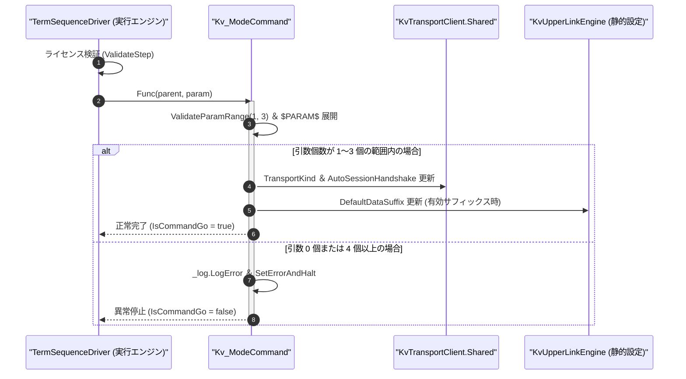

# コマンドリファレンス：Kv_Mode

## 概要

**Kv_Mode** は、KEYENCE KV 上位リンク通信における物理トランスポート方式（`TCP` / `UDP` / `Serial`）、デバイス指定時の既定データ形式サフィックス（`.U` / `.S` / `.H` / `.D` / `.L`）、およびシリアル接続時の `CR` / `CQ` 自動送出フラグをメモリ上で動的に設定・切り替える通信設定系コマンドです。

---

## 💡 書式・パラメータ仕様

### コマンド構文

```csv
,SEQUENCE, [ステップキー], Kv_Mode, [Protocol], "[DataSuffix: .U]", "[AutoSession: ON]"
```

※ `Func` 内の `ValidateParamRange(1, 3)` により **最低 1 個の引数が必須** です（引数 0 個または 4 個以上はエラー停止します。なお `ParameterSpec` 上は各引数に既定値 `"TCP"`, `".U"`, `"ON"` が定義されています）。

### パラメータ（引数）一覧

| 引数位置 | 引数名 | 必須/任意 | 説明・制約 |
| :--- | :--- | :---: | :--- |
| 第 1 引数 | `Protocol` | **必須** | 使用する通信トランスポート方式（`"UDP"` / `"KV/UDP"` は UDP、`"SERIAL"` / `"COM"` / `"RS232C"` / `"UART"` は Serial、それ以外［`"TCP"` 等］は既定の TCP として設定。空文字 `""` 指定時は現在値を維持）。 |
| 第 2 引数 | `DataSuffix` | 任意 | デバイス名にサフィックスが明記されていない場合に付与する既定データ形式（`".U"`, `".S"`, `".H"`, `".D"`, `".L"`、既定: `".U"`。未対応文字列や空文字指定時は現在値を維持）。 |
| 第 3 引数 | `AutoSession` | 任意 | シリアル上位リンク接続時に `Kv_Open` / `Kv_Close` で `CR` / `CQ` を自動送出するかどうか（`"OFF"`, `"FALSE"`, `"0"` 指定時に無効化、それ以外は有効化。既定: `"ON"`）。 |

---

## 🔄 特殊置換規約・分岐規約の適用

本コマンドの引数における特殊記法および解釈ルールです。
* **動的置換（`$`）**: 引数内で `$PARAMキー$` のように記述すると、実行時に変数プール（PARAM）の値へ動的置換されます。（適用可能な引数: 全引数対応）
* **ジャンプ先指定（`#`）**: 本コマンドはジャンプ制御を行わないため適用されません。（適用可能な引数: 非適用）
* **共通コマンド指定（`@`）**: 本コマンドは外部マクロを呼び出さないため、共通コマンド呼び出し記法は適用されません。（適用可能な引数: 非適用）
* **カンマのエスケープ**: 引数自体にカンマを含める場合は、必ず `"..."` と二重引用符で囲んで記述します。
* **エイリアス（別名）**: `Analysis_Kv_Mode`, `Sqn_Kv_Mode`

---

## 💡 動作例（正しい構文での記述例）

### スクリプト記述例

※COMMAND ブロック配下の子要素行（PARAM, SEQUENCE）は必ず行頭カンマから開始し、スペースインデントや行末コメント（`;`）は記述しないでください。

```csv
COMMAND, "SAMPLE_KV_MODE", "RESULT_DM0"
,PARAM, "RESULT_DM0", Work, "DM0読出結果", ""
; 1. TCP 上位リンク、既定データ形式を 16bit 符号付き (.S) に設定
,SEQUENCE, 010, Kv_Mode, "TCP", ".S", "ON"
,SEQUENCE, 020, Kv_Open, "192.168.0.10", "8501", "TCP"
; 2. DM0 から 1 ワードを符号付き整数として読出し RESULT_DM0 へ格納
,SEQUENCE, 030, Kv_ReadWord, "DM0", 1, "RESULT_DM0", "SIGNED"
; 3. 読出値が 0 以上か判定（負数時は #NG_PROC# へ分岐）
,SEQUENCE, 040, Judge, "GE", "$RESULT_DM0$", "0", "#NG_PROC#"
,SEQUENCE, 050, Kv_Close
,SEQUENCE, 060, Exit, "$RESULT_DM0$", 0
; 条件不成立時のクローズ＆異常終了経路
,SEQUENCE, #NG_PROC#, Kv_Close
,SEQUENCE, 080, Exit, "NG", -1
```

### 実行時の挙動・変数変化

* **実行前の状態**: Term 通信エンジンが初期化され、変数プール（`PARAM`）に `"RESULT_DM0"` が定義されている状態。
* **実行後の状態**: `Kv_Mode` により通信を行わずメモリ上のトランスポート方式と既定サフィックス（`.S`）が設定され、`Kv_ReadWord` の結果が `"RESULT_DM0"` に格納された後、`Judge` で判定されて回線をクローズします。

---

## 🔄 動作フロー（シーケンス図）



---

## 🚫 エラーハンドリング・安全設計（仕様制限）

入力データの異常や実行時エラーに対し、解析・実行エンジンが実行するセーフティ規約です。

1. **引数個数バリデーション保護**:
   - 引数が省略された場合（0 個）または 4 個以上指定された場合は、`ValidateParamRange(1, 3)` により `_log.LogError` に詳細を記録し、`SetErrorAndHalt` で停止します。
2. **未知文字列の安全フォールバックおよび例外防御**:
   - 本コマンドは物理通信を行わず設定プロパティのみを更新します。未知の `Protocol` 文字列は既定の `Tcp` へフォールバックし、未対応の `DataSuffix` は無視して直前値を維持します。万一予期せぬ例外が発生した場合は `catch` 節で `_log.LogCritical` と `SetErrorAndHalt(-1, ex.Message)` により安全停止します。

---

## 🧪 ユニットテスト仕様

本コマンドクラス（`Kv_ModeCommand.cs`）に実装されている `RunUnitTest()` メソッドが検証するユニットテストの仕様です。

### テスト実行前提条件

* **実行トリガー**: `RunUnitTest()` メソッドの呼び出し
* **有効化条件**: システム全体の最小ログレベル（`ErrorLogger.MinimumLevel`）が `LogLevel.Test` であること（それ以外の場合は無効化ガードにより早期リターン）
* **検証結果出力**: `_log.LogTest` によるログ出力。検証失敗時は `_log.LogError`、予期せぬ例外発生時は `_log.LogCritical` で記録し、`finally` ブロックで `TransportKind`、`DefaultDataSuffix`、および `AutoSessionHandshake` を開始前の値へ復元します。

### テストケース一覧

| No | テストカテゴリ | テスト条件（入力値） | 期待される結果（出力値） | 検証の目的 / 観点 |
| :---: | :--- | :--- | :--- | :--- |
| **1** | 正常系 | 引数 `"UDP"`, `".S"`, `"OFF"` の 3 引数を指定して実行 | `!param.HasError` かつ `param.IsCommandGo == true`、`TransportKind == KvTransportKind.Udp`、`DefaultDataSuffix == ".S"`、`!AutoSessionHandshake` となる | トランスポート方式・既定データサフィックス・シリアル自動セッション設定の一括反映検証 |
| **2** | 異常系 | 引数 0 個（`new TermSequence { Name = "Kv_Mode" }`）で `Func(null, invalidParam)` を実行 | `ValidateParamRange(1, 3)` により拒否され、`invalidParam.HasError == true` かつ `!invalidParam.IsCommandGo` となる | 必須引数欠落時のバリデーション拒否検証 |
