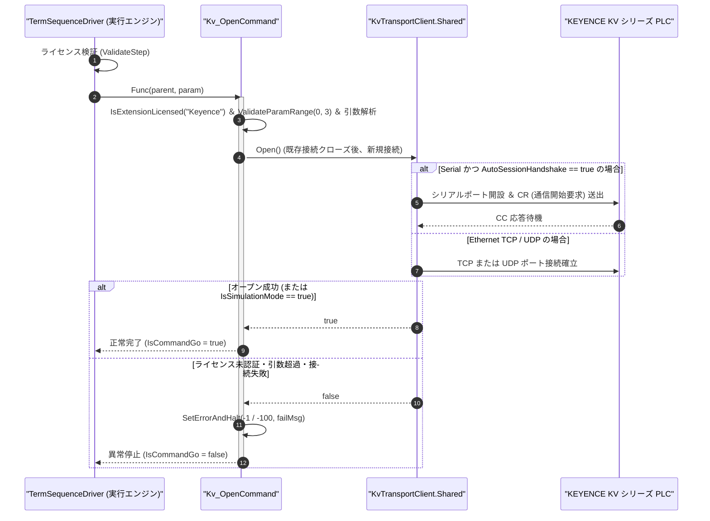

# コマンドリファレンス：Kv_Open

## 概要

**Kv_Open** は、設定値または引数で指定された接続先に基づき、キーエンス（KEYENCE）製 PLC（KV-8000 / KV-7500 / KV-7300 / KV-5500 / KV-5000 / KV-3000 / KV-1000 / KV-Nano シリーズ）との **KV 上位リンク通信回線（Ethernet TCP / UDP 標準ポート 8501、または RS-232C シリアル上位リンク）** を開設する通信制御系コマンドです。
`KvTransportClient.Shared.Open()` を介して接続を確立し、既存の KV ソケットまたはシリアル接続がある場合は安全にクローズした上で新規接続（シリアル接続かつ自動セッション有効時は通信開始要求 `CR\r` の自動送出を含む）を実行します。

---

## 💡 書式・パラメータ仕様

### コマンド構文

```csv
,SEQUENCE, [ステップキー], Kv_Open, "[Endpoint: 192.168.0.10]", "[PortOrOption: 8501]", "[Protocol: TCP]"
```

※ 引数を省略した場合は、UI プロパティ設定画面（または `Kv_Mode`）の現在の設定値が自動適用されます。

### パラメータ（引数）一覧

| 引数位置 | 引数名 | 必須/任意 | 説明・制約 |
| :--- | :--- | :---: | :--- |
| 第 1 引数 | `Endpoint` | 任意 | 接続先 KV ユニットの IP アドレス／ホスト名、またはシリアル COM ポート名（既定: `"192.168.0.10"`）。`"192.168.0.10:8501"` のようなポート同時指定も可能であり、`"COM..."` 指定かつ第 3 引数省略時は自動的に `Serial` モードへ切り替わります。 |
| 第 2 引数 | `PortOrOption` | 任意 | Ethernet 時はポート番号（`1`〜`65535`、既定: `"8501"`。範囲外・非数値時は直前値を維持）、RS-232C シリアル時（またはカンマを含む文字列指定時）は通信条件文字列（既定: `"9600,E,8,1"`）。 |
| 第 3 引数 | `Protocol` | 任意 | 物理トランスポート方式（`"TCP"`, `"UDP"`, `"Serial"` 等、大文字小文字不問）。省略時は UI 設定または現在のモード設定値（既定: `"TCP"`）。 |

---

## 🔄 特殊置換規約・分岐規約の適用

本コマンドの引数における特殊記法および解釈ルールです。
* **動的置換（`$`）**: 引数内で `$PARAMキー$` のように記述すると、実行時に変数プール（PARAM）の値へ動的置換されます。（適用可能な引数: 全引数対応）
* **ジャンプ先指定（`#`）**: 本コマンドはジャンプ制御を行わないため適用されません。（適用可能な引数: 非適用）
* **共通コマンド指定（`@`）**: 本コマンドは外部マクロを呼び出さないため、共通コマンド呼び出し記法は適用されません。（適用可能な引数: 非適用）
* **カンマのエスケープ**: シリアル通信条件文字列（例: `"9600,E,8,1"`）を第 2 引数として渡す場合は、必ず `"..."` と二重引用符で囲んで記述します。
* **エイリアス（別名）**: `Analysis_Kv_Open`, `Sqn_Kv_Open`

---

## 💡 動作例（正しい構文での記述例）

### スクリプト記述例

※COMMAND ブロック配下の子要素行（PARAM, SEQUENCE）は必ず行頭カンマから開始し、スペースインデントや行末コメント（`;`）は記述しないでください。

```csv
COMMAND, "SAMPLE_KV_OPEN", "RCV_DATA"
,PARAM, "RCV_DATA", Work, "DM100読出結果", ""
; 1. KEYENCE KV 上位リンク（IP: 192.168.0.10, Port: 8501, TCP）でオープン
,SEQUENCE, 010, Kv_Open, "192.168.0.10", "8501", "TCP"
; 2. DM100 から 1 ワード読出し RCV_DATA へ格納
,SEQUENCE, 020, Kv_ReadWord, "DM100", 1, "RCV_DATA", "DEC"
; 3. 読出値が閾値 100 以上か判定（未満時は #NG_PROC# へ分岐）
,SEQUENCE, 030, Judge, "GE", "$RCV_DATA$", "100", "#NG_PROC#"
,SEQUENCE, 040, Kv_Close
,SEQUENCE, 050, Exit, "$RCV_DATA$", 0
; 条件不成立時のクローズ＆異常終了経路
,SEQUENCE, #NG_PROC#, Kv_Close
,SEQUENCE, 070, Exit, "NG", -1
```

### 実行時の挙動・変数変化

* **実行前の状態**: Term 通信エンジンが初期化され、変数プール（`PARAM`）に `"RCV_DATA"` が定義されている状態。
* **実行後の状態**: `Kv_Open` により `KvTransportClient.Shared.Open()` が実行されて KV 上位リンク回線が開設され、続く `Kv_ReadWord` で取得された値が `"RCV_DATA"` に格納されます。値が `100` 以上であればクローズ後に正常終了し、未満時は `#NG_PROC#` へ分岐してクローズ後にエラー終了します。

---

## 🔄 動作フロー（シーケンス図）



---

## 🚫 エラーハンドリング・安全設計（仕様制限）

入力データの異常や実行時エラーに対し、解析・実行エンジンが実行するセーフティ規約です。

1. **ライセンス検証および引数範囲ガード**:
   - `Keyence` 拡張ライセンスが未認証の場合はエラーコード `-100` で停止し、引数が 4 個以上指定された場合（`ValidateParamRange(0, 3)` 違反）も `_log.LogError` に詳細を記録して `SetErrorAndHalt` で停止します。
2. **回線再接続制御とオープン失敗時の安全停止**:
   - `KvTransportClient.Shared.Open()` 内部で既存の KV ソケットまたはシリアル接続をクローズしてから新規接続を確立します。実回線モードでオープンに失敗した場合は `SetErrorAndHalt(-1, failMsg)` で停止し、予期せぬ例外発生時は `_log.LogCritical` と `SetErrorAndHalt(-1, ex.Message)` でクラッシュを防ぎます。

---

## 🧪 ユニットテスト仕様

本コマンドクラス（`Kv_OpenCommand.cs`）に実装されている `RunUnitTest()` メソッドが検証するユニットテストの仕様です。

### テスト実行前提条件

* **実行トリガー**: `RunUnitTest()` メソッドの呼び出し
* **有効化条件**: システム全体の最小ログレベル（`ErrorLogger.MinimumLevel`）が `LogLevel.Test` であること（それ以外の場合は無効化ガードにより早期リターン）
* **検証結果出力**: `_log.LogTest` によるログ出力。検証失敗時は `_log.LogError`、予期せぬ例外発生時は `_log.LogCritical` で記録し、`finally` ブロックで `KvTransportClient.Shared.IsSimulationMode` を開始前の状態へ復元します。

### テストケース一覧

| No | テストカテゴリ | テスト条件（入力値） | 期待される結果（出力値） | 検証の目的 / 観点 |
| :---: | :--- | :--- | :--- | :--- |
| **1** | 正常系 | `KvTransportClient.Shared.IsSimulationMode = true` 環境下で引数 `"192.168.0.20"`, `"8501"`, `"TCP"` を指定して実行 | `!param.HasError` かつ `param.IsCommandGo == true`、`Host == "192.168.0.20"`、`Port == 8501`、`TransportKind == KvTransportKind.Tcp` となる | KV 上位リンク TCP 接続先設定および通信回線オープンの検証 |
| **2** | 異常系 | 余剰引数 4 個（`"192.168.0.20"`, `"8501"`, `"TCP"`, `"EXTRA_INVALID"`）を指定して `Func(null, invalidParam)` を実行 | `ValidateParamRange(0, 3)` により拒否され、`invalidParam.HasError == true` かつ `!invalidParam.IsCommandGo` となる | 引数上限超過時のバリデーション拒否検証 |
