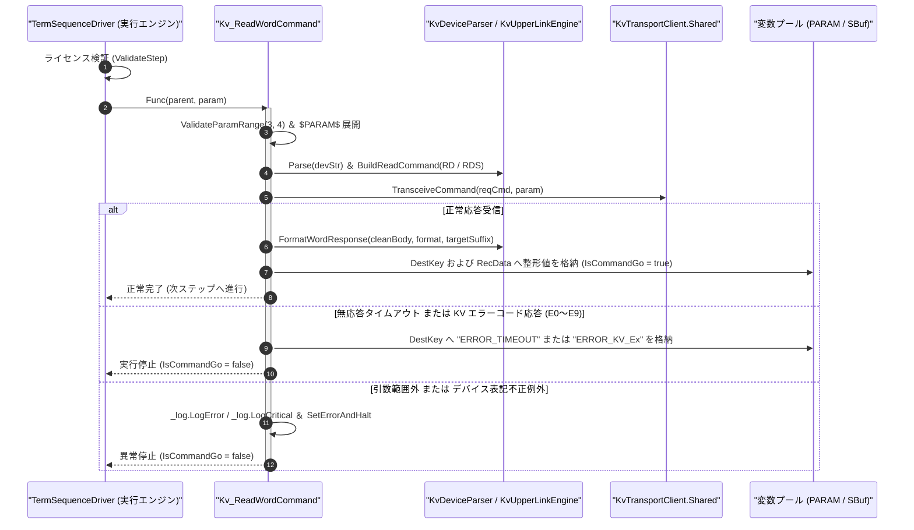

# コマンドリファレンス：Kv_ReadWord

## 概要

**Kv_ReadWord** は、KEYENCE KV 上位リンクの読出コマンド（1 点時 `RD`、複数点時 `RDS`）を用いて、PLC の **ワードデバイス（DM / D, EM, FM, ZF, W, TM, Z, T, TC, C, CC, AT, CM, VM 等）を一括読出** する通信制御系コマンドです。
スペース区切りの上位リンク応答データを解析し、`DEC` / `HEX` / `SIGNED` 指定時はカンマ区切り文字列として、 **`RAW` 指定時はカンマ置換を行わず PLC 応答そのままの半角スペース区切り文字列（改行・前後空白のみ除去）** として結果変数／セルへ自動格納します。

---

## 💡 書式・パラメータ仕様

### コマンド構文

```csv
,SEQUENCE, [ステップキー], Kv_ReadWord, [Device], [Points], [DestKey], "[Format: DEC]"
```

### パラメータ（引数）一覧

| 引数位置 | 引数名 | 必須/任意 | 説明・制約 |
| :--- | :--- | :---: | :--- |
| 第 1 引数 | `Device` | **必須** | 読み出しを開始する先頭デバイス名（対応デバイス: `DM`［省略記法 `D` 可］, `EM`, `FM`, `ZF`, `W`［16進アドレス］, `TM`, `Z`, `T`, `TC`, `TS`, `C`, `CC`, `CS`, `AT`, `CM`, `VM`。`.U`, `.S`, `.H`, `.D`, `.L` サフィックス指定可。例: `"DM100"`, `"D100"`, `"W10"`）。 |
| 第 2 引数 | `Points` | **必須** | 連続して読み出すデバイス点数（`1` 以上の整数文字列。1 点時は `RD`、2 点以上時は `RDS` 電文が自動選択されます。`0` または非数値文字列が渡された場合はエラー停止せず `1` 点へフォールバックします。C# 側での上限遮断は行いませんが、KV 上位リンク仕様上の推奨上限は `1`〜`1000` 点であり、PLC 上限を超過した場合は PLC 側から `E0`/`E1` エラー応答が返却されます）。 |
| 第 3 引数 | `DestKey` | **必須** | 取得したデータ文字列を格納するパラメータキー名（`"@"` や `"$"` を付けない素のキー名、例: `"DM200_VAL"`）。 |
| 第 4 引数 | `Format` | 任意 | 出力フォーマット（`"DEC"`［既定］: 符号なし 10 進カンマ区切り、`"HEX"`: `0x1234` 形式カンマ区切り［32bit 時は 8 桁］、`"SIGNED"`: 符号付き 10 進カンマ区切り、`"RAW"`: カンマ置換せず PLC 応答そのままの半角スペース区切り文字列）。 |

---

## 🔄 特殊置換規約・分岐規約の適用

本コマンドの引数における特殊記法および解釈ルールです。
* **動的置換（`$`）**: 引数内で `$PARAMキー$` のように記述すると、実行時に変数プール（PARAM）の値へ動的置換されます。（適用可能な引数: 全引数対応）
* **ジャンプ先指定（`#`）**: 本コマンドはジャンプ制御を行わないため適用されません。（適用可能な引数: 非適用）
* **共通コマンド指定（`@`）**: 本コマンドは外部マクロを呼び出さないため、共通コマンド呼び出し記法は適用されません。（適用可能な引数: 非適用）
* **カンマのエスケープ**: 引数自体にカンマを含める場合は、必ず `"..."` と二重引用符で囲んで記述します。
* **エイリアス（別名）**: `Kv_Read_Word`, `Analysis_Kv_ReadWord`

---

## 💡 動作例（正しい構文での記述例）

### スクリプト記述例

※COMMAND ブロック配下の子要素行（PARAM, SEQUENCE）は必ず行頭カンマから開始し、スペースインデントや行末コメント（`;`）は記述しないでください。

```csv
COMMAND, "SAMPLE_KV_READWORD", "DM200_VAL"
,PARAM, "DM200_VAL", Work, "DM200読出結果", ""
; 1. 接続開始
,SEQUENCE, 010, Kv_Open, "192.168.0.10", "8501", "TCP"
; 2. DM200 から 3 ワードを一括読出（RDS DM200.U 3）し DM200_VAL へ格納
,SEQUENCE, 020, Kv_ReadWord, "DM200", 3, "DM200_VAL", "DEC"
; 3. 全ゼロ ("0,0,0") でないか判定（全ゼロ時は #NG_PROC# へ分岐）
,SEQUENCE, 030, Judge, "NEQ", "$DM200_VAL$", "0,0,0", "#NG_PROC#"
,SEQUENCE, 040, Kv_Close
,SEQUENCE, 050, Exit, "$DM200_VAL$", 0
; 条件不成立時のクローズ＆異常終了経路
,SEQUENCE, #NG_PROC#, Kv_Close
,SEQUENCE, 070, Exit, "NG", -1
```

### 実行時の挙動・変数変化

* **実行前の状態**: Term 通信エンジンが初期化され、変数プール（`PARAM`）に `"DM200_VAL"` が定義されている状態。
* **実行後の状態**: ステップ `020` で `RDS DM200.U 3` が送受信され、`"DEC"` 指定によりカンマ区切り文字列（例: `"100,250,300"`）が `"DM200_VAL"` に格納されます。後続の `Judge` で全ゼロでないことが確認されると回線を閉じて正常終了し、一致時は `#NG_PROC#` へ分岐してクローズ後にエラー終了します。

---

## 🔄 動作フロー（シーケンス図）



---

## 🚫 エラーハンドリング・安全設計（仕様制限）

入力データの異常や実行時エラーに対し、解析・実行エンジンが実行するセーフティ規約です。

1. **引数範囲およびデバイス構文の検証**:
   - 引数が 2 個以下または 5 個以上の場合は `ValidateParamRange(3, 4)` により `_log.LogError` と `SetErrorAndHalt` で遮断します。未対応デバイスやアドレス不正により `KvDeviceParser.Parse` が例外を送出した場合は、`catch` 節で `_log.LogCritical` に記録し `SetErrorAndHalt(-1, ex.Message)` で安全停止します（`Points` が `0` または非数値の場合は `1` 点へフォールバックします）。
2. **無応答タイムアウトおよび KV エラーコード（`E0`〜`E9`）の検出**:
   - 受信データが空の場合は `DestKey` に `"ERROR_TIMEOUT"` を、KV 本体から `E0`〜`E9` が返された場合は `"ERROR_KV_E0"`〜`"ERROR_KV_E9"` を格納し、`param.IsCommandGo = false` として後続ステップへの誤進行を防止します。

---

## 🧪 ユニットテスト仕様

本コマンドクラス（`Kv_ReadWordCommand.cs`）に実装されている `RunUnitTest()` メソッドが検証するユニットテストの仕様です。

### テスト実行前提条件

* **実行トリガー**: `RunUnitTest()` メソッドの呼び出し
* **有効化条件**: システム全体の最小ログレベル（`ErrorLogger.MinimumLevel`）が `LogLevel.Test` であること（それ以外の場合は無効化ガードにより早期リターン）
* **検証結果出力**: `_log.LogTest` によるログ出力。検証失敗時は `_log.LogError`、予期せぬ例外発生時は `_log.LogCritical` で記録し、`finally` ブロックで `KvTransportClient.Shared.IsSimulationMode` を開始前の状態へ復元します。

### テストケース一覧

| No | テストカテゴリ | テスト条件（入力値） | 期待される結果（出力値） | 検証の目的 / 観点 |
| :---: | :--- | :--- | :--- | :--- |
| **1** | 正常系 | `IsSimulationMode = true` 環境下で引数 `"DM100"`, `"2"`, `"KV_VAL"`, `"DEC"` および擬似応答 `"00100 00250\r\n"` を与えて実行 | `!param.HasError` かつ `param.IsCommandGo == true`、`param.SndData == "RDS DM100.U 2"`、格納先 `SBuf["KV_VAL"] == "100,250"` となる | 連続ワード読出（`RDS`）コマンド構築・数値整形・カンマ区切り格納の検証 |
| **2** | 異常系 | 引数 0 個（`new TermSequence { Name = "Kv_ReadWord" }`）で `Func(null, invalidParam)` を実行 | `ValidateParamRange(3, 4)` により拒否され、`invalidParam.HasError == true` かつ `!invalidParam.IsCommandGo` となる | 必須引数欠落時のバリデーション拒否検証 |
