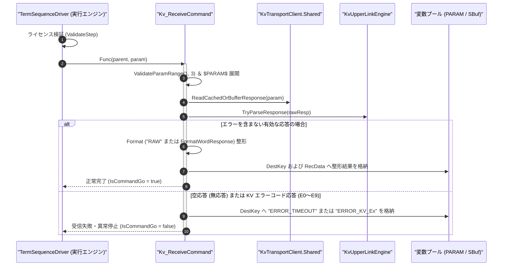

# コマンドリファレンス：Kv_Receive

## 概要

**Kv_Receive** は、`Kv_Send` により送信された上位リンクコマンドに対する PLC からの **ASCII 応答行（`CRLF` 終端）を受信し、`E0`〜`E9` エラー判定を行った上で応答文字列を抽出格納** する汎用受信用コマンドです。
抽出した応答文字列は、第 2 引数 `Format` の指定に従い `"RAW"`（既定）、`"DEC"`、`"HEX"`、または `"SIGNED"` 形式へ変換して `DestKey` に格納します。

---

## 💡 書式・パラメータ仕様

### コマンド構文

```csv
,SEQUENCE, [ステップキー], Kv_Receive, [DestKey], "[Format: RAW]", "[Reserved]"
```

### パラメータ（引数）一覧

| 引数位置 | 引数名 | 必須/任意 | 説明・制約 |
| :--- | :--- | :---: | :--- |
| 第 1 引数 | `DestKey` | **必須** | 受信した応答文字列（改行除去済み）を格納するパラメータキー名（`"@"` や `"$"` を付けない素のキー名、例: `"KV_MODEL"` または `"RUN_MODE"`）。 |
| 第 2 引数 | `Format` | 任意 | 抽出データの整形方式（`"RAW"`［既定］: 改行・前後空白・NUL のみ除去したそのままの応答文字列、`"DEC"` / `"HEX"` / `"SIGNED"`: 空白区切り数値を各形式のカンマ区切り文字列に変換）。 |
| 第 3 引数 | `Reserved` | 任意 | 互換用の予備引数（`ValidateParamRange(1, 3)` により 3 引数まで許容されますが、指定された値は参照されません）。 |

---

## 🔄 特殊置換規約・分岐規約の適用

本コマンドの引数における特殊記法および解釈ルールです。
* **動的置換（`$`）**: 引数内で `$PARAMキー$` のように記述すると、実行時に変数プール（PARAM）の値へ動的置換されます。（適用可能な引数: 全引数対応）
* **ジャンプ先指定（`#`）**: 本コマンドはジャンプ制御を行わないため適用されません。（適用可能な引数: 非適用）
* **共通コマンド指定（`@`）**: 本コマンドは外部マクロを呼び出さないため、共通コマンド呼び出し記法は適用されません。（適用可能な引数: 非適用）
* **カンマのエスケープ**: 引数自体にカンマを含める場合は、必ず `"..."` と二重引用符で囲んで記述します。
* **エイリアス（別名）**: `Kv_R`, `Kv_Res_R`, `Analysis_Kv_Receive`

---

## 💡 動作例（正しい構文での記述例）

### スクリプト記述例

※COMMAND ブロック配下の子要素行（PARAM, SEQUENCE）は必ず行頭カンマから開始し、スペースインデントや行末コメント（`;`）は記述しないでください。

```csv
COMMAND, "SAMPLE_KV_RECEIVE", "RUN_MODE"
,PARAM, "RUN_MODE", Work, "運転モード応答", ""
; 1. 接続開始
,SEQUENCE, 010, Kv_Open, "192.168.0.10", "8501", "TCP"
; 2. 運転モード確認 (?M: 0=PROGRAM, 1=RUN) を送受信し RUN_MODE へ格納
,SEQUENCE, 020, Kv_Send, "?M"
,SEQUENCE, 030, Kv_Receive, "RUN_MODE"
; 3. 運転モードが "1" (RUN) か判定（PROGRAM 時は #NG_PROC# へ分岐）
,SEQUENCE, 040, Judge, "EQU", "$RUN_MODE$", "1", "#NG_PROC#"
,SEQUENCE, 050, Kv_Close
,SEQUENCE, 060, Exit, "$RUN_MODE$", 0
; 条件不成立（非 RUN）時のクローズ＆異常終了経路
,SEQUENCE, #NG_PROC#, Kv_Close
,SEQUENCE, 080, Exit, "NG", -1
```

### 実行時の挙動・変数変化

* **実行前の状態**: `Kv_Send` により `"?M\r"` が送出され、変数プール（`PARAM`）に `"RUN_MODE"` が定義されている状態。
* **実行後の状態**: `Kv_Receive` により応答文字列（改行除去済み、例: `"1"`）が `"RUN_MODE"` に格納され、`Judge`（`"EQU"`）で `"1"`（RUN）と一致する場合は回線を閉じて正常終了し、`"0"`（PROGRAM）の場合は `#NG_PROC#` へ分岐してクローズ後にエラー終了します（※無応答や `E0`〜`E9` 受信時はステップ `030` で即停止します）。

---

## 🔄 動作フロー（シーケンス図）



---

## 🚫 エラーハンドリング・安全設計（仕様制限）

入力データの異常や実行時エラーに対し、解析・実行エンジンが実行するセーフティ規約です。

1. **引数範囲検証および例外防御**:
   - 引数が 0 個または 4 個以上の場合は `ValidateParamRange(1, 3)` により `_log.LogError` と `SetErrorAndHalt` で停止します。また、受信データ変換中に予期せぬ例外が発生した場合は `catch` 節で `_log.LogCritical` に記録し、`SetErrorAndHalt(-1, ex.Message)` で安全停止します。
2. **無応答タイムアウトおよび KV エラーコード（`E0`〜`E9`）の検出**:
   - 応答が空または空白のみの場合は `DestKey` に `"ERROR_TIMEOUT"` を、KV 本体から `E0`〜`E9` が返された場合は `"ERROR_KV_E0"`〜`"ERROR_KV_E9"` を格納し、`param.IsCommandGo = false` として後続ステップへの進行を停止します。

---

## 🧪 ユニットテスト仕様

本コマンドクラス（`Kv_ReceiveCommand.cs`）に実装されている `RunUnitTest()` メソッドが検証するユニットテストの仕様です。

### テスト実行前提条件

* **実行トリガー**: `RunUnitTest()` メソッドの呼び出し
* **有効化条件**: システム全体の最小ログレベル（`ErrorLogger.MinimumLevel`）が `LogLevel.Test` であること（それ以外の場合は無効化ガードにより早期リターン）
* **検証結果出力**: `_log.LogTest` によるログ出力。検証失敗時は `_log.LogError`、予期せぬ例外発生時は `_log.LogCritical` で記録し、`finally` ブロックで `KvTransportClient.Shared.IsSimulationMode` を開始前の状態へ復元します。

### テストケース一覧

| No | テストカテゴリ | テスト条件（入力値） | 期待される結果（出力値） | 検証の目的 / 観点 |
| :---: | :--- | :--- | :--- | :--- |
| **1** | 正常系 | `IsSimulationMode = true` 環境下で引数 `"KV_MODEL"`, `"RAW"` および擬似機種コード応答 `"55\r\n"` を与えて実行 | `!param.HasError` かつ `param.IsCommandGo == true`、格納先 `SBuf["KV_MODEL"]` が改行除去済みの `"55"` と一致する | 上位リンク ASCII 応答の改行トリム・エラー照合および `RAW` 格納の検証 |
| **2** | 異常系 | 引数 0 個（`new TermSequence { Name = "Kv_Receive" }`）で `Func(null, invalidParam)` を実行 | `ValidateParamRange(1, 3)` により拒否され、`invalidParam.HasError == true` かつ `!invalidParam.IsCommandGo` となる | 必須引数 `DestKey` 欠落時のバリデーション拒否検証 |
