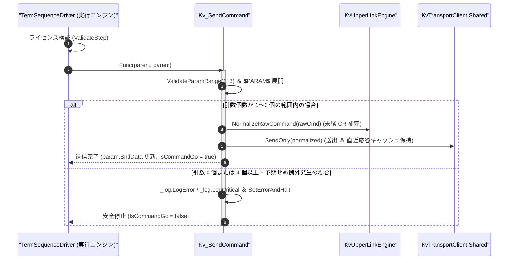

# コマンドリファレンス：Kv_Send

## 概要

**Kv_Send** は、任意の KEYENCE KV 上位リンク ASCII コマンド文字列へ終端コード `CR`（`\r`）を自動付与して PLC へ直接送出する汎用送信用コマンドです。
メモリ読書き以外のシステム制御・情報取得コマンド（`?K` 機種コード確認、`?M` 運転モード確認、`M1` RUN 切替、`M0` PROGRAM 切替、`?E` エラー確認、`WRT` 時計設定等）の送信に使用し、送出時の即時応答を後続の `Kv_Receive` 向けに内部キャッシュします。

---

## 💡 書式・パラメータ仕様

### コマンド構文

```csv
,SEQUENCE, [ステップキー], Kv_Send, [Command], "[Reserved2]", "[Reserved3]"
```

### パラメータ（引数）一覧

| 引数位置 | 引数名 | 必須/任意 | 説明・制約 |
| :--- | :--- | :---: | :--- |
| 第 1 引数 | `Command` | **必須** | 送信する上位リンク ASCII コマンド文字列（例: `"?K"`, `"?M"`, `"M1"`, `"RD DM0.U"`。末尾の `\r` は `NormalizeRawCommand` により自動補完されます。なお空文字 `""` が指定された場合は空文字列のままエラー停止せず `IsCommandGo = true` で完了します）。 |
| 第 2〜3 引数 | `Reserved2`, `Reserved3` | 任意 | 互換用の予備引数（`ValidateParamRange(1, 3)` により最大 3 引数まで許容されますが、第 2・第 3 引数の値は参照されません）。 |

---

## 🔄 特殊置換規約・分岐規約の適用

本コマンドの引数における特殊記法および解釈ルールです。
* **動的置換（`$`）**: 引数内で `$PARAMキー$` のように記述すると、実行時に変数プール（PARAM）の値へ動的置換されます。（適用可能な引数: 全引数対応）
* **ジャンプ先指定（`#`）**: 本コマンドはジャンプ制御を行わないため適用されません。（適用可能な引数: 非適用）
* **共通コマンド指定（`@`）**: 本コマンドは外部マクロを呼び出さないため、共通コマンド呼び出し記法は適用されません。（適用可能な引数: 非適用）
* **カンマのエスケープ**: 引数自体にカンマを含める場合は、必ず `"..."` と二重引用符で囲んで記述します。
* **エイリアス（別名）**: `Kv_S`, `Analysis_Kv_Send`

---

## 💡 動作例（正しい構文での記述例）

### スクリプト記述例

※COMMAND ブロック配下の子要素行（PARAM, SEQUENCE）は必ず行頭カンマから開始し、スペースインデントや行末コメント（`;`）は記述しないでください。

```csv
COMMAND, "SAMPLE_KV_SEND", "KV_MODEL"
,PARAM, "KV_MODEL", Work, "KV機種コード", ""
; 1. 接続開始
,SEQUENCE, 010, Kv_Open, "192.168.0.10", "8501", "TCP"
; 2. 接続先 KV の機種コード問合せコマンド (?K) を送信
,SEQUENCE, 020, Kv_Send, "?K"
; 3. 機種コード応答を受信し KV_MODEL へ格納
,SEQUENCE, 030, Kv_Receive, "KV_MODEL"
; 4. 取得した機種コードが空でないか判定（空の場合は #NG_PROC# へ分岐）
,SEQUENCE, 040, Judge, "NEQ", "$KV_MODEL$", "", "#NG_PROC#"
,SEQUENCE, 050, Kv_Close
,SEQUENCE, 060, Exit, "$KV_MODEL$", 0
; 条件不成立時のクローズ＆異常終了経路
,SEQUENCE, #NG_PROC#, Kv_Close
,SEQUENCE, 080, Exit, "NG", -1
```

### 実行時の挙動・変数変化

* **実行前の状態**: Term 通信エンジンが初期化され、変数プール（`PARAM`）に `"KV_MODEL"` が定義されている状態。
* **実行後の状態**: `Kv_Send` により `"?K\r"` が送出されて `param.SndData` に `"?K"` が記録され、即時応答がトランスポート内部に保持されます。続く `Kv_Receive` で機種コード文字列が `"KV_MODEL"` に格納され、`Judge` で判定後に回線をクローズします。

---

## 🔄 動作フロー（シーケンス図）



---

## 🚫 エラーハンドリング・安全設計（仕様制限）

入力データの異常や実行時エラーに対し、解析・実行エンジンが実行するセーフティ規約です。

1. **引数範囲バリデーション保護**:
   - 引数が省略された場合（0 個）または 4 個以上の引数が指定された場合は、`ValidateParamRange(1, 3)` により `_log.LogError` に詳細を記録し、`SetErrorAndHalt` で停止します（なお第 1 引数が空文字 `""` の場合は空文字列に正規化され、エラー停止せず通過します）。
2. **送信処理中の例外防御**:
   - `SendOnly` 内部での通信例外はトランスポート層で捕捉されてログ記録され、応答検証自体は後続の `Kv_Receive` 側で行われます。`Func` 内で万一予期せぬ例外が発生した場合は、`catch` 節で `_log.LogCritical` に記録し `SetErrorAndHalt(-1, ex.Message)` で安全停止します。

---

## 🧪 ユニットテスト仕様

本コマンドクラス（`Kv_SendCommand.cs`）に実装されている `RunUnitTest()` メソッドが検証するユニットテストの仕様です。

### テスト実行前提条件

* **実行トリガー**: `RunUnitTest()` メソッドの呼び出し
* **有効化条件**: システム全体の最小ログレベル（`ErrorLogger.MinimumLevel`）が `LogLevel.Test` であること（それ以外の場合は無効化ガードにより早期リターン）
* **検証結果出力**: `_log.LogTest` によるログ出力。検証失敗時は `_log.LogError`、予期せぬ例外発生時は `_log.LogCritical` で記録し、`finally` ブロックで `KvTransportClient.Shared.IsSimulationMode` を開始前の状態へ復元します。

### テストケース一覧

| No | テストカテゴリ | テスト条件（入力値） | 期待される結果（出力値） | 検証の目的 / 観点 |
| :---: | :--- | :--- | :--- | :--- |
| **1** | 正常系 | `IsSimulationMode = true` 環境下で第 1 引数 `Command` に `"?K"`（機種コード問合せ）を指定して実行 | `!param.HasError` かつ `param.IsCommandGo == true`、`param.SndData == "?K"`（送出電文は末尾 `\r` 付与済み）となる | 任意上位リンク ASCII コマンドの正規化および送出処理の検証 |
| **2** | 異常系 | 引数 0 個（`new TermSequence { Name = "Kv_Send" }`）で `Func(null, invalidParam)` を実行 | `ValidateParamRange(1, 3)` により拒否され、`invalidParam.HasError == true` かつ `!invalidParam.IsCommandGo` となる | 必須引数 `Command` 欠落時のバリデーション拒否検証 |
