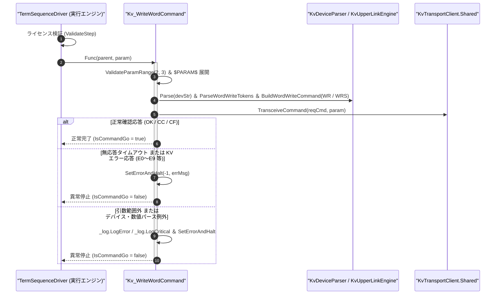

# コマンドリファレンス：Kv_WriteWord

## 概要

**Kv_WriteWord** は、KEYENCE KV 上位リンクの書込コマンド（1 点時 `WR`、複数点時 `WRS`）を用いて、PLC の **ワードデバイス（DM / D, EM, FM, ZF, W, TM, Z, T, TC, C, CC, AT, CM, VM 等）へ一括書込** を行う通信制御系コマンドです。
書き込み完了後、KV 本体からの正常確認応答（`OK` / `CC` / `CF`）を自動検証します。

---

## 💡 書式・パラメータ仕様

### コマンド構文

```csv
,SEQUENCE, [ステップキー], Kv_WriteWord, [Device], [Values], "[Reserved]"
```

### パラメータ（引数）一覧

| 引数位置 | 引数名 | 必須/任意 | 説明・制約 |
| :--- | :--- | :---: | :--- |
| 第 1 引数 | `Device` | **必須** | 書き込みを開始する先頭ワードデバイス名（対応デバイス: `DM`［省略記法 `D` 可］, `EM`, `FM`, `ZF`, `W`［16進アドレス］, `TM`, `Z`, `T`, `TC`, `C`, `CC`, `AT`, `CM`, `VM`。サフィックス省略時は `Kv_Mode` の既定サフィックスを適用。例: `"DM100"`, `"DM100.S"`, `"W0"`）。 |
| 第 2 引数 | `Values` | **必須** | 書き込む数値列（カンマまたは空白区切り、10 進整数または `0x` 付き 16 進数。1 個なら `WR`、2 個以上なら `WRS` 電文が自動構築されます。例: `"100, 200"` または `"0x1234, 0x5678"`）。 |
| 第 3 引数 | `Reserved` | 任意 | 互換用の予備引数（`ValidateParamRange(2, 3)` により 3 引数まで許容されますが、指定された値は参照されません）。 |

---

## 🔄 特殊置換規約・分岐規約の適用

本コマンドの引数における特殊記法および解釈ルールです。
* **動的置換（`$`）**: 引数内で `$PARAMキー$` のように記述すると、実行時に変数プール（PARAM）の値へ動的置換されます。（適用可能な引数: 全引数対応）
* **ジャンプ先指定（`#`）**: 本コマンドはジャンプ制御を行わないため適用されません。（適用可能な引数: 非適用）
* **共通コマンド指定（`@`）**: 本コマンドは外部マクロを呼び出さないため、共通コマンド呼び出し記法は適用されません。（適用可能な引数: 非適用）
* **カンマのエスケープ**: 複数データのカンマ区切り値（例: `"1, 255"`）を単一引数として渡す場合は、必ず `"..."` と二重引用符で囲んで記述します。
* **エイリアス（別名）**: `Kv_Write_Word`, `Analysis_Kv_WriteWord`

---

## 💡 動作例（正しい構文での記述例）

### スクリプト記述例

※COMMAND ブロック配下の子要素行（PARAM, SEQUENCE）は必ず行頭カンマから開始し、スペースインデントや行末コメント（`;`）は記述しないでください。

```csv
COMMAND, "SAMPLE_KV_WRITEWORD", ""
; 1. 接続開始
,SEQUENCE, 010, Kv_Open, "192.168.0.10", "8501", "TCP"
; 2. DM101 に 1、DM102 に 255 を一括書込（WRS DM101.U 2 1 255）
,SEQUENCE, 020, Kv_WriteWord, "DM101", "1, 255"
; 3. 切断
,SEQUENCE, 030, Kv_Close
,SEQUENCE, 040, Exit
```

### 実行時の挙動・変数変化

* **実行前の状態**: `Kv_Open` により KEYENCE KV（`192.168.0.10:8501`, TCP）との通信回線が開設されている状態。
* **実行後の状態**: ステップ `020` で `"WRS DM101.U 2 1 255\r"` が送受信され、KV 本体からの `"OK"` 応答が確認されて `param.IsCommandGo = true` となり、ステップ `030` の `Kv_Close` へ進みます。

---

## 🔄 動作フロー（シーケンス図）



---

## 🚫 エラーハンドリング・安全設計（仕様制限）

入力データの異常や実行時エラーに対し、解析・実行エンジンが実行するセーフティ規約です。

1. **引数範囲およびデバイス・数値構文の検証**:
   - 引数が 1 個以下または 4 個以上の場合は `ValidateParamRange(2, 3)` により `_log.LogError` と `SetErrorAndHalt` で遮断します。未対応デバイスや数値書式不正により `KvDeviceParser.Parse` / `ParseWordWriteTokens` が例外を送出した場合は、`catch` 節で `_log.LogCritical` に記録し `SetErrorAndHalt(-1, ex.Message)` で安全停止します。
2. **書込応答タイムアウトおよび KV エラーコード時の停止**:
   - 受信データが空／空白のみ（タイムアウト）の場合、または KV 本体から `E0`〜`E9` エラーや非 `OK` 応答が返された場合は、`SetErrorAndHalt(-1, ...)` を呼び出してシーケンスを即座に安全停止します。

---

## 🧪 ユニットテスト仕様

本コマンドクラス（`Kv_WriteWordCommand.cs`）に実装されている `RunUnitTest()` メソッドが検証するユニットテストの仕様です。

### テスト実行前提条件

* **実行トリガー**: `RunUnitTest()` メソッドの呼び出し
* **有効化条件**: システム全体の最小ログレベル（`ErrorLogger.MinimumLevel`）が `LogLevel.Test` であること（それ以外の場合は無効化ガードにより早期リターン）
* **検証結果出力**: `_log.LogTest` によるログ出力。検証失敗時は `_log.LogError`、予期せぬ例外発生時は `_log.LogCritical` で記録し、`finally` ブロックで `KvTransportClient.Shared.IsSimulationMode` を開始前の状態へ復元します。

### テストケース一覧

| No | テストカテゴリ | テスト条件（入力値） | 期待される結果（出力値） | 検証の目的 / 観点 |
| :---: | :--- | :--- | :--- | :--- |
| **1** | 正常系 | `IsSimulationMode = true` 環境下で引数 `"DM200"`, `"100,255"` および擬似応答 `"OK\r\n"` を与えて実行 | `!param.HasError` かつ `param.IsCommandGo == true`、`param.SndData == "WRS DM200.U 2 100 255"` となる | 連続ワード書込（`WRS`）コマンド自動生成および `OK` 応答検証 |
| **2** | 異常系 | 引数 0 個（`new TermSequence { Name = "Kv_WriteWord" }`）で `Func(null, invalidParam)` を実行 | `ValidateParamRange(2, 3)` により拒否され、`invalidParam.HasError == true` かつ `!invalidParam.IsCommandGo` となる | 必須引数欠落時のバリデーション拒否検証 |
