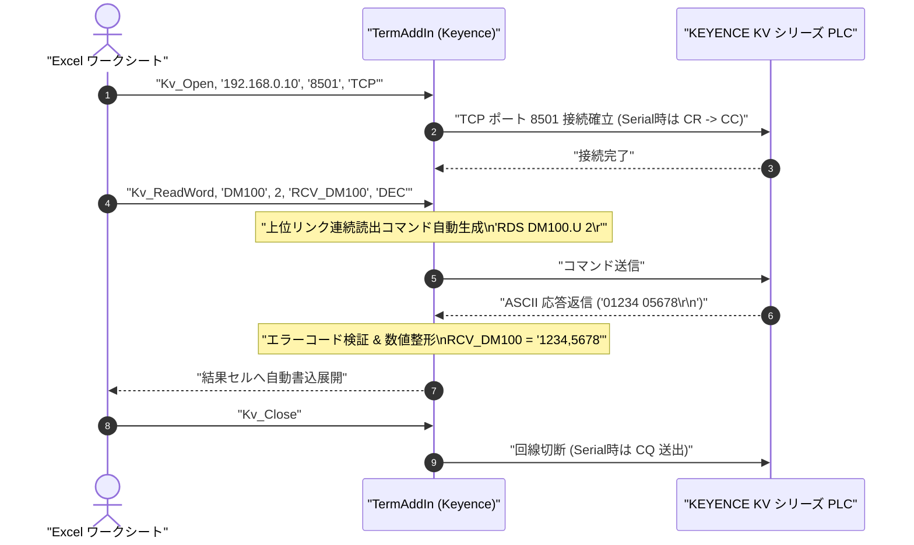



# TermAddIn_Keyence - キーエンス KV 上位リンク通信エクステンション

👉 [← TermAddIn 統合本体に戻る](https://github.com/Monaca-App/TermAddIn)  
👉 [← Monaca アプリ工房（トップ）に戻る](https://github.com/Monaca-App/store)

---

[](https://www.microsoft.com/)
[](https://www.microsoft.com/excel)
[](https://dotnet.microsoft.com/)
[]()
[]()

## 📖 概要

**TermAddIn_Keyence** は、Excel 総合通信アドイン **TermAddIn** 上で動作する ** キーエンス（KEYENCE）製 PLC（KV-8000 / KV-7500 / KV-7300 / KV-5500 / KV-5000 / KV-3000 / KV-1000 / KV-Nano シリーズ）向け KV 上位リンク通信専用エクステンション（機能ドメイン単一 DLL）** です。

KV シリーズの内蔵 Ethernet ポート・Ethernet ユニット（KV-EP21V / KV-LE21V 等）・RS-232C シリアルポートと、 **Ethernet TCP / UDP 上位リンク（標準ポート 8501） ** および **RS-232C シリアル上位リンク（`CR` / `CQ` セッション自動送出対応）** を用いてダイレクトに交信します。

VBA マクロを一切記述することなく、 **標準の `.xlsx`（マクロ無効ブック）形式のままで KV 各種データメモリ・リレー（DM, EM, FM, ZF, W, TM, Z, R, MR, LR, CR, B 等）の一括読出・一括書込、および任意上位リンクコマンド送受信** を高速・安全に実行できます。

> [!NOTE]
> **利用前提とライセンス体系**  
> 本エクステンションは [TermAddIn 本体](https://github.com/Monaca-App/TermAddIn) 上で動作します。  
> TermAddIn ではプロトコル毎に個別ライセンスを設ける体系を採用しており、本機能のご利用には **`TermAddIn_Keyence` 個別ライセンス（一括 ¥49,000 / 月額 ¥4,400 / 週額 ¥1,500・税別）** が適用されます（ライセンス未配置・無効時は、Excel アドイン（`TermAddIn`）・`Term.exe` 単体起動ともに 10 分間の期間限定版として動作します）。

---

## ✨ 主な機能・特徴

1. **Ethernet（TCP / UDP ポート 8501）& RS-232C シリアル上位リンク両対応**
   * 設定レスで高速交信できる **Ethernet TCP / UDP 上位リンク（標準ポート 8501） ** に加え、シリアルポート経由での **`CR` / `CQ` 自動セッション管理付き RS-232C 上位リンク ** にも対応。 **[TermEmulator](https://github.com/Monaca-App/TermEmulator)** の KEYENCE KV 上位リンク仮想スレーブ（Ethernet 直結、または `TermEmulator` ドライバレス仮想 COM ホスト／無償仮想シリアル中継ツール **[c2c](https://github.com/Monaca-App/c2c)** の仮想 COM ペア経由、本ライセンス共用可）とも実機なしで直結テストが可能。
2. **KV デバイス & データ形式サフィックス（`.U` / `.S` / `.H` / `.D` / `.L`）完全対応**
   * `DM`, `D`, `EM`, `FM`, `ZF`, `TM`, `Z`, `T`, `TC`, `TS`, `C`, `CC`, `CS`, `AT`, `CM`, `VM`（10進）、`W`（16進リンクレジスタ）、`R`, `MR`, `LR`, `CR`（10進リレー）、`B`, `VB`（16進リレー）およびデータ形式指定サフィックスを自動識別。
3. **単一点・連続アクセス電文の自動最適化（RD/RDS, WR/WRS, ST/RS）**
   * `Kv_ReadWord`, `Kv_WriteWord`, `Kv_ReadBit`, `Kv_WriteBit` が指定点数に応じて単一点コマンド（`RD`, `WR`, `ST`, `RS`）と連続コマンド（`RDS`, `WRS`）を自動選択し、`E0`〜`E9` エラー応答も厳密に検知。
4. **任意上位リンク ASCII コマンド送受信（Kv_Send / Kv_Receive）**
   * `?K`（機種確認）、`?M`（運転モード確認）、`M1` / `M0`（モード切替）、`?E`（CPU エラー確認）、`WRT`（時計書込）など全上位リンクコマンドを送受信可能。
5. **Excel 32bit / 64bit 完全動作マトリクス**
   * .NET Framework 4.8 標準マネージド通信基盤のみで内製実装されており、外部の専用 ActiveX やネイティブ DLL に依存しないため、Excel 32bit 版・64bit 版の双方で完全動作。

---

## 🔌 提供コマンド一覧（全 9 コマンド）

各コマンドの詳細な構文・パラメータ仕様・記述例は、以下の個別リファレンスをご参照ください。

### 回線制御・通信条件設定コマンド（3 コマンド）

| コマンド名 | 構文概要 | 主な役割・用途 | 詳細マニュアル |
| :--- | :--- | :--- | :---: |
| **`Kv_Open`** | `Kv_Open, "[Endpoint]", "[PortOrOption]", "[Protocol]"` | KV 上位リンク回線（TCP/UDP 8501 または Serial）を開設 | [詳細説明](./Manual/Keyence/Kv_Open.Md) |
| **`Kv_Close`** | `Kv_Close` | 通信回線を安全に切断（Serial 時は `CQ` 自動送出可） | [詳細説明](./Manual/Keyence/Kv_Close.Md) |
| **`Kv_Mode`** | `Kv_Mode, "[Protocol]", "[DataSuffix]", "[AutoSession]"` | トランスポート方式・既定データサフィックス・自動 `CR`/`CQ` 設定 | [詳細説明](./Manual/Keyence/Kv_Mode.Md) |

### デバイスアクセス・高水準コマンド（4 コマンド）

| コマンド名 | 構文概要 | 主な役割・用途 | 詳細マニュアル |
| :--- | :--- | :--- | :---: |
| **`Kv_ReadWord`** | `Kv_ReadWord, "[Device]", [Points], "[DestKey]", "[Format]"` | ワードデバイス読出（`RD` / `RDS`） | [詳細説明](./Manual/Keyence/Kv_ReadWord.Md) |
| **`Kv_WriteWord`** | `Kv_WriteWord, "[Device]", "[Values]"` | ワードデバイス書込（`WR` / `WRS`、`OK` 応答検証） | [詳細説明](./Manual/Keyence/Kv_WriteWord.Md) |
| **`Kv_ReadBit`** | `Kv_ReadBit, "[Device]", [Points], "[DestKey]"` | リレー／ビット状態読出（`RD` / `RDS`） | [詳細説明](./Manual/Keyence/Kv_ReadBit.Md) |
| **`Kv_WriteBit`** | `Kv_WriteBit, "[Device]", "[Values]"` | リレー／ビット書込（1点 `ST`/`RS`、複数点 `WRS`） | [詳細説明](./Manual/Keyence/Kv_WriteBit.Md) |

### 汎用上位リンク送受信コマンド（2 コマンド）

| コマンド名 | 構文概要 | 主な役割・用途 | 詳細マニュアル |
| :--- | :--- | :--- | :---: |
| **`Kv_Send`** | `Kv_Send, "[Command]"` | 任意の KV 上位リンク ASCII コマンド（`?K`, `?M` 等）を送信 | [詳細説明](./Manual/Keyence/Kv_Send.Md) |
| **`Kv_Receive`** | `Kv_Receive, "[DestKey]", "[Format]"` | 上位リンク応答を受信・`E0`〜`E6` エラー検証後にデータ抽出 | [詳細説明](./Manual/Keyence/Kv_Receive.Md) |

---

## 💻 動作環境・システム要件

| 項目 | システム要件 |
| :--- | :--- |
| **OS** | Windows 10 / Windows 11 (64bit / 32bit) |
| **対応 Excel** | Microsoft Excel 2016 / 2019 / 2021 / Microsoft 365 (デスクトップ版 32bit / 64bit) |
| **必須アドイン** | [TermAddIn](https://github.com/Monaca-App/TermAddIn) (Excel VSTO アドイン) |
| **対象 PLC** | キーエンス KV-8000 / KV-7500 / KV-7300 / KV-5500 / KV-5000 / KV-3000 / KV-1000 / KV-Nano シリーズ（内蔵 Ethernet ポート、KV-EP21V、KV-LE21V、KV-L21V 等） |
| **対応プロトコル** | KEYENCE KV 上位リンク通信（Ethernet TCP/IP・UDP/IP 標準ポート 8501、RS-232C シリアル上位リンク） |

---

## 🚀 インストール手順

<a href="https://github.com/Monaca-App/TermAddIn_Keyence/raw/main/Setup/TermAddIn_Keyence_Setup.zip">
  
</a>

> 上記の **「プログラム（入手）」アイコン** をクリックすると、セットアッププログラム一式（[`TermAddIn_Keyence_Setup.zip`](https://github.com/Monaca-App/TermAddIn_Keyence/raw/main/Setup/TermAddIn_Keyence_Setup.zip)）が直接ダウンロードされます。展開後、`TermAnalysis.Keyence\setup.exe`（または `TermAnalysis.Keyence.Setup.msi`）を実行してください。

> [!IMPORTANT]
> **導入前提**  
> 本エクステンションを利用するには、事前に **[TermAddIn 本体](https://github.com/Monaca-App/TermAddIn)** （`Term.Setup` および `TermAddIn.Setup`）をインストールしておく必要があります。

### 配布アーカイブ（本リポジトリ `Setup/` 配下）

* **アーカイブ**: [`Setup/TermAddIn_Keyence_Setup.zip`](https://github.com/Monaca-App/TermAddIn_Keyence/raw/main/Setup/TermAddIn_Keyence_Setup.zip)（収録内容: `TermAnalysis.Keyence/setup.exe`, `TermAnalysis.Keyence/TermAnalysis.Keyence.Setup.msi`）

### 導入ステップ

1. **Microsoft Excel** および **Term** をすべて終了します。
2. ダウンロードした **`TermAddIn_Keyence_Setup.zip`** を展開し、 **`TermAnalysis.Keyence/`** フォルダ内の **`setup.exe`** （または **`TermAnalysis.Keyence.Setup.msi`** ）を実行します。
   * ※ 管理者権限（UAC 承認）が必要です。
   * ※ 拡張 DLL は共通インストール先（`C:\Program Files (x86)\Monaca_App_Store\Monaca Common\`）へ配置され、サンプル資材が `C:\Program Files (x86)\Monaca_App_Store\Monaca Sample\Keyence\` へ導入されます。
3. インストール完了後、Excel（または `Term.exe`）を起動し、メイン画面の **`[通信モード]`** メニューから **`KEYENCE KV`** が選択できることを確認します。

### アンインストール手順
* Windows の「設定」>「アプリ」>「インストールされているアプリ」（または「コントロールパネル」の「プログラムと機能」）から **`TermAnalysis.Keyence.Setup`** を選択してアンインストールしてください。

---

## 🔄 通信シーケンスの概要

### KV データメモリ一括読出の流れ



---

## 🔰 シーケンス記述例・同梱サンプル資材（`Sample/Keyence/`）

Ethernet TCP 上位リンクを用いた KV データメモリ（`DM100`〜`DM101`）一括読出の構成例です。

```csv
; 1. KEYENCE KV 上位リンク通信回線をオープン（TCP/IP, Port 8501）
,SEQUENCE, 010, Kv_Open, "192.168.0.10", "8501", "TCP"
; 2. DM100 から 2 ワード一括読出を実行（10進形式）
,SEQUENCE, 020, Kv_ReadWord, "DM100", 2, "PLC_DM100", "DEC"
; 3. 通信回線をクローズして終了
,SEQUENCE, 030, Kv_Close
,SEQUENCE, 040, Exit
```

### 同梱サンプルマクロ・AI自動生成プロンプト集
Ethernet（TCP/UDP）および RS-232C シリアル上位リンクに対応した動作確認用マクロスクリプト（CSV）および AI 自動生成プロンプトが **`Sample/Keyence/`** に収録されています（インストール時には `C:\Program Files (x86)\Monaca_App_Store\Monaca Sample\Keyence\` へ配置され、デスクトップの `Monaca\Sample` ショートカットから参照できます）。

* **[`Sample/Keyence/Keyence_KV.csv`](./Sample/Keyence/Keyence_KV.csv)**: KEYENCE KV 上位リンク汎用マクロスクリプトサンプル
* **[`Sample/Keyence/Keyence_KV_prompt.md`](./Sample/Keyence/Keyence_KV_prompt.md)**: KEYENCE KV 上位リンク用マクロスクリプト AI 自動生成プロンプト

---

## 💳 ライセンス・購入プラン（TermAddIn_Keyence）

> [!NOTE]
> **試用動作およびオンライン決済について**  
> ライセンス未配置・無効時は、Excel アドイン（`TermAddIn`）・`Term.exe` 単体起動ともに 10 分間の期間限定版として動作します（10 分超過後は未保有機能のみスルー／ロック）。  
> 用途や利用期間に合わせて、一括購入（買い切り）またはサブスクリプション（月額・週額）からお選びいただけます。メールアドレスの誤入力によるライセンス不着を防ぐため、 **事前のメールアドレス確認** を行った上で、 **Stripe** による安全なオンライン決済へご案内いたします（表記価格はすべて税別です）。

| プラン | 価格（税別） | お支払い・お申込み |
| :--- | :---: | :---: |
| **一括購入（買い切りライセンス）**<br>無期限で永続利用できるライセンスです。 | **¥49,000** | [👉 一括購入手続きへ](https://stripe-license-generator.y-nakai-5a3.workers.dev/?target=keyence) |
| **月額サブスクリプション**<br>月単位で利用できる定期プランです。中長期のプロジェクトにおすすめです。 | **¥4,400** / 月 | [👉 月額プランに申し込む](https://stripe-license-generator.y-nakai-5a3.workers.dev/?target=keyence) |
| **週額サブスクリプション**<br>週単位で手軽に利用できるプランです。短期評価や単発テストにおすすめです。 | **¥1,500** / 週 | [👉 週額プランに申し込む](https://stripe-license-generator.y-nakai-5a3.workers.dev/?target=keyence) |

* ※ **ライセンスファイル名**: `TermAddIn_Keyence.License`
* ※ **配置先**: `%USERPROFILE%\Desktop\Monaca\TermAddIn_Keyence.License`（設定ファイル `Setting.xml` と同階層）
* ※ **ライセンス形態**: 1 ユーザー / 1 PC（ノードロック方式：`PC名` および `ログインユーザー名` に紐づけ）

---

## 📄 ライセンス & サポート

* **開発元**: [Monaca アプリ工房 (Monaca App Store)](https://github.com/Monaca-App/store)
* **親プロジェクト**: [TermAddIn](https://github.com/Monaca-App/TermAddIn)
* **関連ツール・シミュレータ**: [TermEmulator - 汎用仮想デバイス＆PLCスレーブ・エミュレータ](https://github.com/Monaca-App/TermEmulator) ／ [c2c - ドライバ不要の仮想ヌルモデム＆通信モニター](https://github.com/Monaca-App/c2c)
* **Copyright**: Copyright (C) Monaca App Store 2026 All rights reserved.
* **お問い合わせ**: 不具合報告や機能要望は、GitHub の Issue までお気軽にお寄せください。

